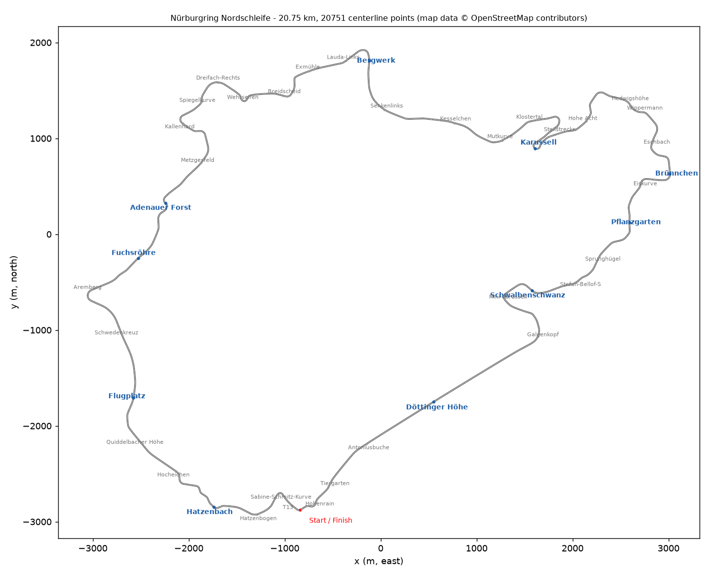
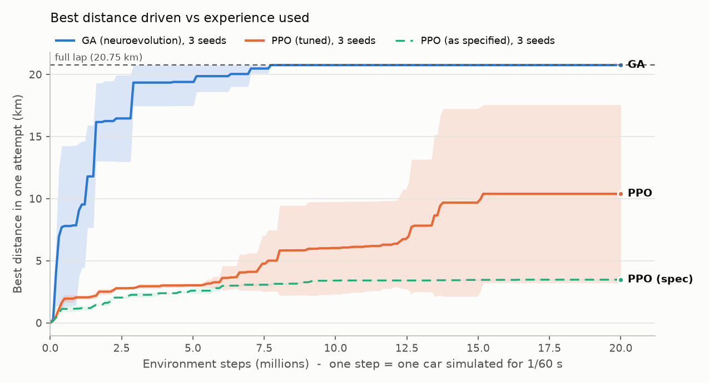
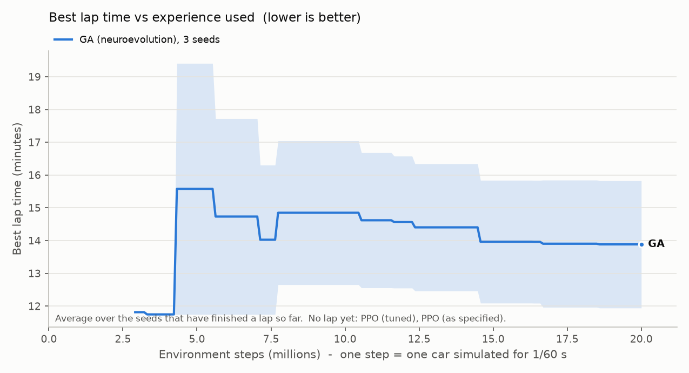

# nurburgringML

100 AI cars learn to drive the **Nürburgring Nordschleife** (20.8 km, 73 corners), using
two different learning methods that are compared fairly:

* **Neuroevolution (genetic algorithm, GA)**: 100 small neural networks race; the best
  ones are bred and mutated into the next generation.
* **Reinforcement learning (PPO)**: one neural network drives all 100 cars, and it is improved
  by gradient descent on the experience they collect.

Everything that touches the simulation or the networks is batched **PyTorch**: all 100 cars
are updated by the same tensor operations, with no `for car in cars` loop anywhere.
**pygame** draws it and **matplotlib** saves the comparison plots.



---

## Quick start

```bash
python -m venv .venv
# Windows:  .venv\Scripts\activate        macOS / Linux:  source .venv/bin/activate
pip install -r requirements.txt
python main.py
```

`python main.py` opens a window where the GA starts learning immediately. Press `4` to
run at full speed and `Tab` for the whole-track view.

Notes on the requirements:

* `requirements.txt` adds PyTorch's CUDA package index, so on Windows/Linux with an NVIDIA
  GPU you get a CUDA build (on macOS pip falls back to the normal build, which supports Apple
  MPS). The device is picked automatically: CUDA → MPS → CPU. Use `--device cpu` to override
  (see *Performance* below: for 100 cars the CPU is usually faster).
* It uses **pygame-ce**, a drop-in fork of pygame (the code still says `import pygame`).
  Classic pygame has no wheels for Python 3.14.

## All the ways to run it

| Command | What it does |
|---|---|
| `python main.py` | GA training with the viewer |
| `python main.py --algo ppo` | PPO training with the viewer |
| `python main.py --algo ga --headless --generations 100` | GA without a window (fastest) |
| `python main.py --algo ppo --headless --max-steps 20e6` | PPO without a window, stop after 20 M env steps |
| `python main.py --algo ga --load checkpoints/ga_seed0/latest.pt` | resume training from a checkpoint |
| `python main.py --watch checkpoints/ppo_seed0/latest.pt` | watch the best saved driver (deterministic, 1 car, lap timer) |
| `python main.py --watch PATH --headless` | print how far / how fast the saved driver gets |
| `python main.py --seed 3` | different random seed |
| `python main.py --cars 1000 --device cuda` | more cars (bigger GA population / more PPO environments), see *More cars* |
| `python compare.py` | the full GA-vs-PPO experiment (see below) |
| `python compare.py --budget 5e6 --seeds 0,1` | a quick version of it |
| `python compare.py --plot-only` | redraw the plots from existing CSVs |
| `python track.py` | rebuild the track and save a labelled map to `results/track.png` |
| `python tools/fetch_osm.py` | re-download the track from OpenStreetMap |
| `python tools/bench.py` | simulation speed on CPU vs GPU |
| `python tools/snapshot.py --algo ga` | render viewer frames to PNG without a window |
| `python record.py` | record replays of saved checkpoints for the browser viewer (see below) |
| `cd web && python -m http.server 8001` | try the browser replay viewer at http://localhost:8001 |
| `pytest` / `pytest -m "not slow"` | run the tests (`pip install -r requirements-dev.txt` first) |

Checkpoints are written to `checkpoints/{algo}_seed{n}/latest.pt`, plus a numbered copy every
10 generations (GA) or 50 updates (PPO), when you press `S`, and when you quit. `--load` continues
from one; `--watch` drives with one.

### Viewer keys

| Key | Action |
|---|---|
| `Space` | pause / resume |
| `1` `2` `3` | 1× / 5× / 20× simulation steps per frame |
| `4` | maximum speed (screen refreshes twice per second) |
| `Tab` | follow camera ↔ full-track overview |
| `V` | show / hide the leader's raycasts |
| `R` | put all cars back on the start line (GA: restarts the current generation) |
| `S` | save a checkpoint |
| `Esc` | quit (saves a checkpoint) |

In GA mode cars are coloured by fitness rank (green = best). In PPO mode they are coloured by how
far around the lap they have got. The white-outlined car is the leader; the camera follows it and
draws its 9 raycasts. The HUD shows the algorithm, generation or update, environment steps, cars
alive, best distance, best lap, leader speed and device. The bottom-left panel is the live
learning curve.

---

## Browser replay viewer (`web/`)

`web/` is a static website (plain HTML + JavaScript + Canvas, no build step, no frameworks) that replays
recorded checkpoints, so anyone can watch without installing Python:

* all 100 cars of a generation driving from the start line, the best car highlighted with a trail;
* GA, PPO, or **side by side at the same number of environment steps**;
* **every GA generation (1–101)**: step through them with the training-progress slider or type a generation number
  in the box next to it; play/pause, 1×/4×/16× playback and a scrubbable timeline;
* follow-the-best-car or full-track camera, labelled corners;
* per-replay stats (best distance, lap time, laps finished, cars still driving over time), the learning-curve
  plots from `results/` and a plain-language "how it works";
* phone-friendly layout; the address bar keeps the current view (`#mode=split&gen=3&t=60&cam=follow`), so links
  are shareable.

### Try it locally

```bash
cd web
python -m http.server 8001        # any free port; the default is 8000
```

Then open http://localhost:8001. Opening `index.html` straight from disk does not work, because browsers
block JavaScript modules and data loading from `file://` pages.

### Publish it with GitHub Pages

Every path in `web/` is relative, so the folder works at any URL.

* **Option A (recommended): GitHub Actions.** The repo includes `.github/workflows/pages.yml`, which publishes
  `web/`. One-time setup: *Settings → Pages → Build and deployment → Source: GitHub Actions*. Then push to `main`
  (or run the workflow from the *Actions* tab). The site appears at `https://<user>.github.io/<repo>/`, for this
  repo **https://jaeruilab.github.io/nurburgringML/**.
* **Option B: no workflow.** *Settings → Pages → Deploy from a branch → `main`, `/ (root)`*. The viewer is then
  at `https://<user>.github.io/<repo>/web/`.

The viewer unpacks the replay files with the browser's built-in `DecompressionStream`
(Chrome/Edge 80+, Safari 16.4+, Firefox 113+).

### Re-recording the replays

```bash
# 1. train with a checkpoint for every GA generation and log-spaced PPO checkpoints
python main.py --algo ga  --headless --seed 1 --generations 100 --save-every 1
python main.py --algo ppo --headless --seed 0 --threads 1 --max-steps 125e6 --save-every 1000000000 --save-log-ratio 1.1
# 2. replay every generation (6 processes in parallel, ~20 min) and write web/data/
python record.py
python record.py --gens 1,5,20,50,100,final     # or just a few
```

* **GA, generation g:** the population as it was at the start of that generation (checkpoint `ga_{g-1}`),
  driven exactly as in training. Replays are deterministic, and `record.py` prints the training log's best
  distance next to the replay's so you can see they match.
* **PPO:** for each GA replay, the PPO checkpoint with the closest number of environment steps. PPO has one
  driver, so its 100 cars differ only through the (seeded) exploration noise; the noise-free driver's result is
  shown separately.
* **Format:** per car, x/y at 20 Hz as int16 (0.2 m resolution) stored as second differences, plus heading
  keyframes 5 times a second (~0.35°, interpolated in the browser), all gzipped. Heading jitters a little every
  frame and was 80% of the data, so storing it less often made the files ~4× smaller: the heaviest generation
  (50+ cars driving a full lap) is ~0.35 MB. Each replay's file and its per-car results (`<id>.json`) are only
  downloaded when you open it, so the page loads fast even though all 167 replays (101 GA generations + 66 PPO checkpoints) add up to ~21 MB.
  `record.py`'s docstring describes the layout, `web/js/decode.js` reads it, and a test checks the two agree.

---

## How it works

### The track (`track.py`, `data/nordschleife.geojson`)

The centerline is the real one from **OpenStreetMap** (route relation 38566, 451 points after
simplification). The data file is ordinary GeoJSON (lon/lat), so you can swap in any other track:
put a `LineString` (in driving order, starting at the start line) and optional named `Point`
features for corner labels into a GeoJSON file and point `TrackConfig.path` at it. Plain x/y meters
(`.json` with `{"points": [[x, y], ...]}` or a `.csv` with `x,y` columns) also work, and
`latlon_to_local_m()` converts coordinates.

At start-up the points are:

1. converted to local meters,
2. smoothed with a **centripetal Catmull-Rom spline** and resampled every 1 m (~20 750 points),
3. given tangents, normals, curvature, cumulative arc length, and left/right edges 5.5 m either side,
4. rasterised into a **0.5 m occupancy grid** (a big true/false image of the asphalt). Checking
   "is this car off the track?" or tracing a ray is then just reading pixels.

### The environment (`env.py`)

All state is tensors shaped `(N, ...)`, one row per car.

* **Physics** (60 Hz): a kinematic bicycle model. Throttle is traction-limited at low speed and
  power-limited at high speed; drag sets a top speed of ~290 km/h; brakes give 1.2 g. Cornering
  is limited by grip (1.4 g). If the steering asks for more, the car **understeers** (turns
  less than asked) and the sliding tyres scrub off speed. Steering is speed-sensitive, as in
  most racing games: at speed, full lock asks for 1.5× the grip limit.
* **Observation** (13 numbers): 9 raycasts from −90° to +90° (log-scaled distance to the track
  edge, up to 150 m), speed, heading error relative to the track direction, and the track's
  curvature 50 m and 150 m ahead. The rays are computed for all cars at once as an
  `(N, 9, 128)` block of sample points and a single grid lookup.
* **Action** (2 numbers in [−1, 1]): steering, and throttle (+) / brake (−).
* **Progress**: each car is projected onto the centerline by searching only the ~20 segments
  around where it was last step (vectorised).
* **A car's episode ends** when it leaves the asphalt, drives >10 m backwards, makes <5 m progress
  in 3 s, completes a lap, or hits the 20-minute time limit.
* **Reward** (PPO only): meters of progress + 0.002 × speed − 10 for crashing + a lap bonus
  that is bigger for faster laps.
* **Two reset modes**: `reset_all()` (GA: everyone on the grid each generation; crashed cars
  freeze) and `step(auto_reset=True)` (PPO: a crashed car respawns immediately at a random point
  on the track, so all 100 cars keep producing experience).

### The genetic algorithm (`brain.py`, `ga.py`)

* All 100 brains (13 → 16 → 16 → 2, tanh) live in **one** `(100, 530)` tensor of "genes". The
  forward pass uses `torch.bmm`: 100 small matrix multiplications in one call.
* **Fitness** = distance driven + 0.2 × average speed + (for a finished lap) 20 000 × 500 s / lap time.
* **Breeding**, all as tensor operations: the top 5 are copied unchanged (**elitism**). Each of
  the other 95 gets two parents chosen by **tournament selection** (best of 3 random brains), takes
  each gene from one parent or the other by coin flip (**uniform crossover**), then gets a little
  Gaussian noise on every gene (**mutation**; σ starts at 0.1 and shrinks 0.5% per generation).
* A generation ends when every car has crashed (or after 20 minutes of sim time). Crashed cars are
  dropped from the batch so the survivors run faster; a test checks this changes no results.

### PPO (`ppo.py`)

* **One** actor-critic network drives all 100 cars: shared 13 → 64 → 64 tanh body, a policy head
  (mean steering/throttle) and a value head ("how good is this situation?"), plus a learnable
  exploration noise `log_std`.
* **Rollout**: 256 steps × 100 cars = 25 600 experiences per update. Observations are normalised
  with running mean/std.
* **GAE** (γ = 0.99, λ = 0.95) turns rewards into advantages ("better or worse than expected?"),
  cutting the chain where a car's episode ended. If a car only ran out of time, the critic's estimate
  of the next state is added (it didn't fail).
* **Update**: 4 epochs of minibatches of 4096 with the clipped PPO objective (ε = 0.2),
  value loss × 0.5, entropy bonus × 0.01, Adam 3e-4, gradient-norm clip 0.5.
* Logged every update: mean episode return, mean distance before crash, best lap, policy loss,
  value loss, entropy, approximate KL, clip fraction.

---

## GA vs PPO: what's the difference?

| | Genetic algorithm | PPO |
|---|---|---|
| **Who drives** | 100 different brains, one per car | one brain drives all 100 cars |
| **How it learns** | keep the best brains, mix and mutate them: trial and error at the level of *whole brains* | gradient descent: nudge the single network toward actions that turned out *better than expected*, step by step |
| **Feedback used** | one number per car per generation (its fitness) | a reward every 1/60 s for every car |
| **Exploration** | random mutations of the weights | random noise added to the actions |
| **Needs gradients?** | no (works with any score you can measure) | yes (backpropagation through the network) |
| **Typical strengths** | simple, robust, parallel; behaves the same every time (deterministic policies) | far more information per experience; keeps improving on everything it sees |
| **Typical weaknesses** | throws away almost everything that happened during a run; a generation lasts as long as its best car survives | more moving parts and hyperparameters; trained with noisy actions, so it has to learn to be robust to its own noise |

A useful way to think about it: the GA asks *"which of these 100 drivers is best?"* and
PPO asks *"in this exact situation, would steering a bit more left have been better?"*

## The fair comparison (`compare.py`)

A GA generation and a PPO update are completely different amounts of work, so both are measured
in **environment steps**: one step is one car driving for 1/60 s, and only steps where a car is
actually driving count (a crashed GA car standing still costs nothing). Both methods get the same
budget (default 50 M steps) and 3 random seeds each, all running in parallel processes.

Outputs in `results/`:

* `compare_distance.png`: best single-attempt distance vs. env steps (mean ± std over seeds)
* `compare_laptime.png`: best lap time vs. env steps (lower is better)
* `{algo}_seed{n}.csv` (one learning curve per run) and `compare_summary.csv`
* a printed summary table: final best distance and lap, steps to first full lap, wall-clock time,
  and a **deterministic evaluation lap** (the GA's best brain and PPO's mean action, each driving
  one car from the start grid).

Two things to keep in mind when reading the numbers:

* PPO trains with random starts and noisy actions, and its "best distance" is from those noisy
  episodes. The deterministic evaluation column is the like-for-like test of the final driver.
* The GA's wall-clock time depends on how long its best cars survive. A generation can't finish
  before its slowest survivor does, and those steps can't be parallelised.

### Results (20 M steps × 3 seeds, on the development machine)




| Method | Best distance after 20 M steps | Best lap | Steps to first lap | Training time | Noise-free driver from the grid |
|---|---|---|---|---|---|
| GA | full lap (20.75 km), 3/3 seeds | 13:53 ± 1:57 (best 11:35) | 5.0 M ± 2.0 M | 36 ± 5 min | laps in 13:44 ± 1:58 |
| PPO as specified (γ 0.99, entropy 0.01) | 3.47 ± 0.04 km | no lap | never | 15 min | 5 / 255 / 288 m |
| PPO tuned (γ 0.999, entropy 0, rewards ×0.2; now the default) | 10.4 ± 7.2 km (3.7 / 20.3 / 7.1) | no lap | never | 15 min | 284 / 0 / 276 m |

(`results/ppo_spec/` keeps the as-specified PPO curves; the plots above show the tuned PPO.)

* **The GA learned the whole track.** Every seed got past the first corners within ~1 M steps and completed
  full laps after 3–8 M steps. Once found, a lapping brain is never lost (elitism), and later generations
  steadily improve the lap time.
* **PPO as specified hit a ceiling at ~3.5 km.** Its mean distance before a crash rose from ~20 m to ~1 km
  (from random starts), and it stayed there even after 150 M steps (best 3.8 km). Driven without exploration noise
  from the start line it crashes at the first corner (Sabine-Schmitz-Kurve).
* **Why, and the fix.** With γ = 0.99 at 60 steps per second PPO only looks ~1.7 s ahead, too short to learn
  where to brake. A sanity check on an easy 1.8 km loop showed the code learns (it lapped there), but with
  the same braking weakness. Raising γ to 0.999 (~17 s) tripled the distance, but the entropy bonus then made the
  exploration noise grow until the driving fell apart again. A 4-way sweep at γ = 0.999 found that switching the
  entropy bonus off works best: the noise shrinks steadily, and one 20 M-step run **finished full laps** (first
  lap 16:29; its noise-free driver lapped from the start line in 14:42). Those values are now the defaults.
* **Tuned PPO is much better but unreliable.** All five tuned runs broke the old ceiling (3.7–20.3 km in 20 M
  steps), but only that one lapped. A 135 M-step tuned run reached 19.1 km (92% of a lap) without completing one,
  with large swings in between. Its noise-free driver still usually fails the standing start into the first
  corner, which random-start training rarely practises.
* **Starting some episodes on the start line didn't fix that.** With 20% / 50% of respawns on the start line
  (`grid_start_prob`), the best attempts were 7.3 / 12.0 km in 20 M steps, so the option stays off by default.
* **The lapping run is reproducible.** Single-threaded runs are deterministic, so
  `python main.py --algo ppo --headless --seed 0 --threads 1` repeats the run that laps (first lap at ~16 M steps);
  the browser viewer's PPO replays come from that run.
* **Wall-clock.** PPO processed steps ~2.5× faster. A GA generation can't finish before its best car does, so
  long-surviving cars make the GA slower per step. It still reached a full lap first.
* These numbers come from one machine and a handful of seeds; treat them as a starting point, not a verdict
  on either method.

---

## Hyperparameters (`config.py`)

Every number is in `config.py`. The defaults are the values below.

### Track (`TrackConfig`)
| Name | Default | What it does |
|---|---|---|
| `path` | `data/nordschleife.geojson` | centerline file |
| `width` | 11 m | track width (edges are ±width/2 from the centerline) |
| `spline_ds` | 1 m | spacing of the smoothed centerline used for progress and curvature |
| `grid_cell` | 0.5 m | occupancy-grid resolution (smaller = more exact edges, more memory) |
| `grid_margin` | 160 m | empty border around the track; ≥ ray length so rays never leave the grid |
| `curvature_smooth_near` / `_far` | 10 m / 40 m | smoothing windows for the two curvature look-aheads |

### Car (`CarConfig`)
| Name | Default | What it does |
|---|---|---|
| `wheelbase` | 2.6 m | bicycle-model axle distance (shorter = turns tighter) |
| `max_steer` | 0.45 rad | steering lock at low speed |
| `steer_overdrive` | 1.5 | at speed, full steering demands this × the grip limit (above 1 = can slide) |
| `max_accel` | 7 m/s² | traction-limited acceleration |
| `power_per_mass` | 300 W/kg | acceleration at speed is P/v |
| `max_brake` | 12 m/s² | full-brake deceleration |
| `drag`, `rolling` | 0.00055, 0.2 | drag (sets the ~80 m/s top speed) and rolling resistance |
| `grip` | 14 m/s² | max cornering acceleration (~1.4 g) |
| `scrub_decel` | 8 m/s² | extra slowing while the front tyres slide |
| `v_max` | 80 m/s | speed normalisation for the observation |

### Environment (`EnvConfig`)
| Name | Default | What it does |
|---|---|---|
| `n_cars` | 100 | cars simulated in parallel (GA population size / PPO parallel envs) |
| `dt` | 1/60 s | physics step |
| `n_rays`, `ray_fov_deg`, `ray_max` | 9, 180°, 150 m | the raycast "eyes" |
| `ray_samples`, `ray_spacing_power` | 128, 1.5 | samples per ray, denser near the car |
| `ray_log_scale` | on | rays reported as log(1+d)/log(1+150) so near walls are well resolved |
| `heading_err_scale` | π/4 | heading error that maps to 1.0 |
| `curv_ahead_near` / `_far`, `curv_scale` | 50 m / 150 m, 30 | where curvature is looked up; ×30 so a 30 m radius → 1.0 |
| `window_back` / `window_fwd` | 5 / 15 | centerline segments searched each step for progress |
| `no_progress_time`, `min_progress` | 3 s, 5 m | "stuck" rule |
| `backwards_tolerance` | 10 m | "driving backwards" rule |
| `max_episode_time` | 1200 s | episode / generation time limit |
| `reward_speed_coef`, `crash_penalty`, `lap_bonus` | 0.002, 10, 100 | PPO reward terms |
| `ref_lap_time` | 500 s | reference lap for lap bonuses (the scripted test driver laps in 8:32) |

### Genetic algorithm (`GAConfig`)
| Name | Default | What it does |
|---|---|---|
| `hidden` | (16, 16) | brain size: 13 → 16 → 16 → 2 |
| `elites` | 5 | best brains copied unchanged |
| `tournament_k` | 3 | brains per tournament (bigger = stronger selection, less diversity) |
| `crossover_prob` | 0.5 | chance a gene comes from parent A |
| `mutation_prob` | 1.0 | chance a gene is mutated (1.0 = every gene a little) |
| `sigma_init`, `sigma_decay`, `sigma_min` | 0.1, 0.995, 0.01 | mutation size and its slow decay |
| `fitness_speed_coef` | 0.2 | small bonus per m/s of average speed |
| `fitness_lap_bonus` | 20 000 | bonus for a lap (× ref_lap_time / lap_time) |
| `max_generation_time` | 1200 s | generation cut-off |
| `normalize_obs`, `obs_clip` | on, 5 | standardise brain inputs (statistics refreshed each generation) |

### PPO (`PPOConfig`)
| Name | Default | What it does |
|---|---|---|
| `hidden` | 64 | actor-critic body: 13 → 64 → 64 |
| `rollout_steps` | 256 | steps per car between updates (× 100 cars = 25 600 samples) |
| `gamma` | 0.999 | discount: how much future reward counts (≈ 17 s horizon at 60 Hz; spec: 0.99 ≈ 1.7 s) |
| `gae_lambda` | 0.95 | bias/variance trade-off of the advantage estimate |
| `epochs`, `minibatch_size` | 4, 4096 | passes over each rollout and minibatch size |
| `clip_eps` | 0.2 | how far one update may move the policy's probabilities |
| `vf_coef`, `ent_coef` | 0.5, 0.0 | weights of the value loss and the entropy bonus (spec: 0.01, which made the noise grow) |
| `lr`, `max_grad_norm` | 3e-4, 0.5 | Adam learning rate and gradient clipping |
| `init_log_std` | −0.5 | starting exploration noise (std ≈ 0.61) |
| `init_throttle_bias` | 0.5 | starting mean throttle (see notes) |
| `obs_clip`, `reward_scale`, `norm_adv` | 10, 0.2, on | observation clipping, reward scaling (keeps value targets small at γ = 0.999), advantage normalisation |
| `random_start` | on | respawn crashed cars anywhere on the track |

### Comparison / rendering
`CompareConfig`: `budget` (50 M), `seeds` (0, 1, 2), `out_dir`, `grid_points`.
`RenderConfig`: window size, FPS, redraw interval in max-speed mode.

---

## Design notes (and where the spec was interpreted)

* **Real geometry.** The track is the actual OpenStreetMap centerline rather than hand-placed points;
  all 42 named sections (Hatzenbach, Flugplatz, Fuchsröhre, Adenauer Forst, Bergwerk, Karussell,
  Brünnchen, Pflanzgarten, Schwalbenschwanz, Döttinger Höhe, …) come from OSM way names.
* **GA input normalisation.** With raw inputs the GA got stuck at the first corner (277 m) for
  over 50 generations: the elite was a full-throttle car, and small-range inputs such as heading
  error barely registered. Standardising the inputs (as PPO does) together with dense, small
  mutations got it lapping within a few million steps. The statistics are refreshed between
  generations, so an elite can score slightly differently in the next generation. The saved best
  brain keeps the normalisation it was scored with, so `--watch` reproduces it.
* **PPO throttle bias.** With a zero-mean initial policy the cars mostly sat still (brake is stronger
  than throttle) until the stuck rule fired, so every episode looked the same (−10) and there was
  almost no learning signal. `init_throttle_bias = 0.5` starts the policy rolling; set it to 0 to see
  the slow start.
* **"No progress" = less than 5 m in 3 s.** With 1 m, cars creeping at walking pace survived for
  the full 20-minute limit and made GA generations extremely long.
* **PPO defaults differ from the spec:** `gamma` 0.999 (spec 0.99), `ent_coef` 0 (spec 0.01) and `reward_scale` 0.2.
  With the spec values PPO plateaued at ~3.5 km; see *Results* for the experiments behind the change. Set them
  back in `config.py` to reproduce the as-specified runs (`results/ppo_spec/`).
* **Step counting** counts only cars that are actually driving.
* **R key** resets the cars to the start line (non-destructive) instead of wiping training.

### Performance and more cars

Every tensor has one row per car, so the number of cars is a single setting: `--cars N` on
`main.py` and `compare.py` (or `EnvConfig.n_cars`). In the GA it is the population size; in PPO it is
the number of parallel environments, so each update sees `256 × N` samples.

With few cars the tensors are tiny and the cost is per-operation overhead, not arithmetic, so extra cars
are almost free until the hardware is actually busy. `python tools/bench.py --cars N` measures it. On
the development machine (i9-10850K, RTX 2060, Windows):

| Cars | CPU (car-steps/s) | RTX 2060 (car-steps/s) |
|---|---|---|
| 100 | 53 k | 21 k |
| 200 | 64 k | 40 k |
| 500 | 81 k | 103 k |
| 1 000 | 100 k | 176 k |
| 2 000 | 107 k | 286 k |
| 5 000 | 108 k | 403 k |

The CPU tops out around 100 k car-steps/s. The GPU's time per step barely changes until ~500 cars, so
above that it pulls far ahead: use `--cars 1000 --device cuda` or more. The viewer draws 1 000–2 000 cars at
60 FPS. `main.py` auto-selects the GPU as specified and prints a tip when the car count is small enough
that the CPU would be faster. `compare.py` defaults to `--device cpu` because it runs several seeds in
parallel processes; for large `--cars` use `--device cuda --workers 2` or so.

Resuming with a different car count works: `--load ... --cars 200` refills a GA population by cycling
through the saved brains (elites first); a PPO network doesn't depend on the number of cars at all.

## Project layout

```
main.py        CLI: train (viewer or headless), resume, watch
config.py      every hyperparameter (dataclasses)
track.py       track loading, spline, boundaries, curvature, occupancy grid
env.py         vectorised environment (physics, raycasts, progress, rewards)
brain.py       population of networks as one batched weight tensor
ga.py          genetic algorithm trainer
ppo.py         PPO trainer (actor-critic, GAE, clipped objective)
trainer.py     shared trainer plumbing (checkpoints, headless loop)
compare.py     GA vs PPO experiment, plots and summary
record.py      record checkpoint replays for the browser viewer
render.py      pygame viewer
utils.py       device selection, seeding, running mean/std, checkpoint helpers
data/          nordschleife.geojson (OpenStreetMap)
tools/         fetch_osm.py, bench.py, snapshot.py
web/           static browser replay viewer (index.html, css/, js/, data/)
.github/       GitHub Pages workflow for web/
tests/         pytest suite
```

## Credits

Track geometry © [OpenStreetMap](https://www.openstreetmap.org/copyright) contributors, available under
the Open Database License (ODbL 1.0).
